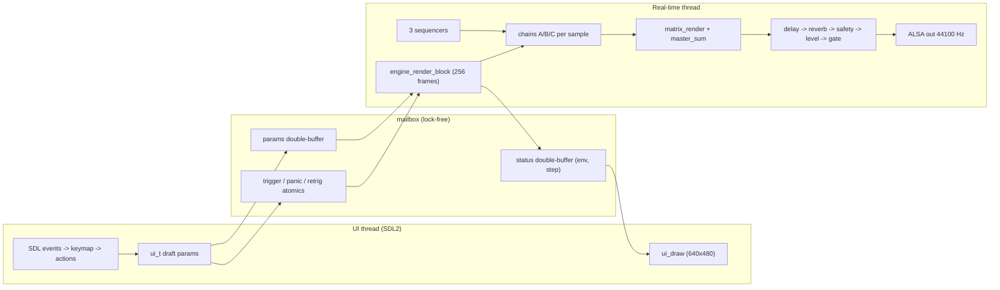
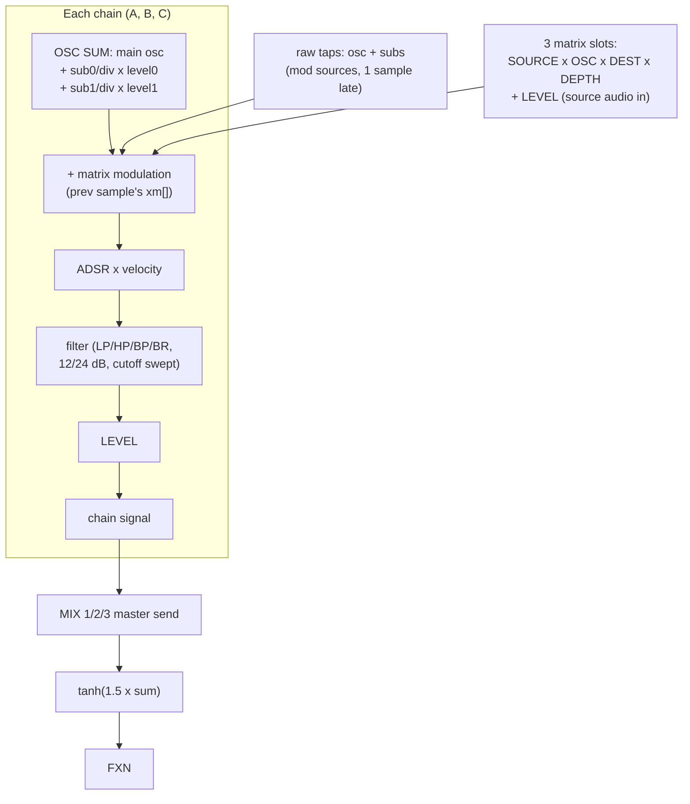

# ARCHITECTURE.md — ophis-drone, concise as-built

One process, two threads, no locks between them. Specs: `PLAN.md`
(product) and `IMPLEMENTATION.md` (contracts); this is the map.

## 1. Threads and data flow

Rules: the UI never touches the audio thread; all traffic goes through
the mailbox (seqlock double-buffers + atomics). No allocations, no
locks, no syscalls in the render path.

## 2. Signal flow (per sample)

- Subs are Subharmonicon-style voices: `parent_f / div` (integer
  1..16), own wave/duty/LEVEL; they modulate only via the matrix.
- Destinations: PITCH, PHASE, AMP, FLT CUT, FLT RES, RING, FM
  (`mod_apply` in dsp/mixer.c is the single scaling convention).
- CHFM and the old per-osc mix dest are gone (the matrix generalizes
  them). Frequency rows edit as 5-digit odometer boxes; every numeric
  field rolls over at its bounds.

## 3. Module map

| Path | Role |
|---|---|
| `src/dsp/` | pure DSP: `osc`, `subosc`, `chain`, `mixer` (matrix + master), `filter` (biquads), `adsr`, `fx`, shared `types` |
| `src/audio/` | `engine` (block loop, transport), `mailbox` (lock-free), `alsa_pcm` |
| `src/seq/` | sequencer: fwd/pingpong/oddeven/random/markov, 8 steps x3 |
| `src/preset/` | `schema_tab` (enum tables), `schema_write` (arena writer), `schema_parse` (table-driven walker), `preset` (file IO), `defaults` |
| `src/ui/` | `ui` (state machine), `ui_menu` (menus/dialogs), `ui_draw` (renderer), `valrepeat` (hold-repeat), `keymap` (desktop/R36S bindings), `seq_items` (item tables + page model), `range`, `theme`, `font8x8` |
| `src/app/` | `main` (threads, event loop), `autoquit` (smoke env) |
| `tests/` | 25 unit/integration binaries (no ALSA; engine-level pins included) |
| `tools/` | `migrate_presets` (parse->write->re-parse->memcmp), `handheld_gate.sh`, launcher |
| `third_party/` | vendored `json.h` (Unlicense) |

## 4. Preset format (version 1)

JSON, minified by the writer; strict parser (required keys, exact
array lengths 3/2/8/3, enum strings, ranges, duplicate keys rejected,
unknown keys skipped). Key groups: chain (osc + 2 subs + adsr +
filter + mixvol), seq (8 steps), xmod (3 slots: src/tgt/dest/amount/
mix), delay, reverb, bpm, master, safety. Shipped presets are
canonical writer output, verified by re-parse + memcmp.
