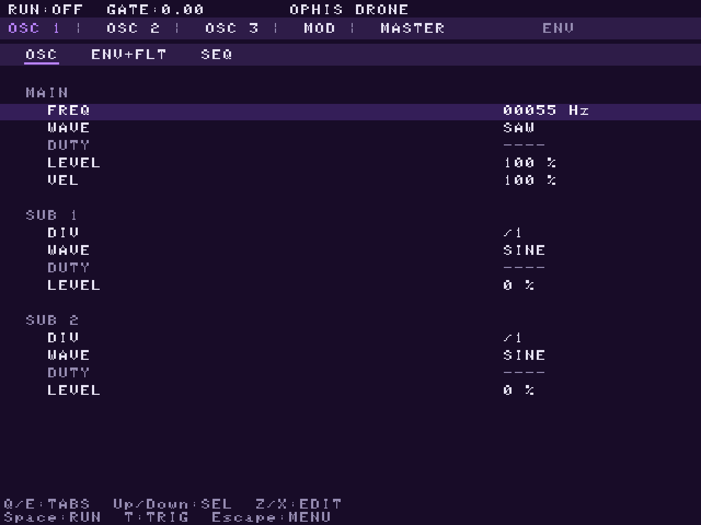
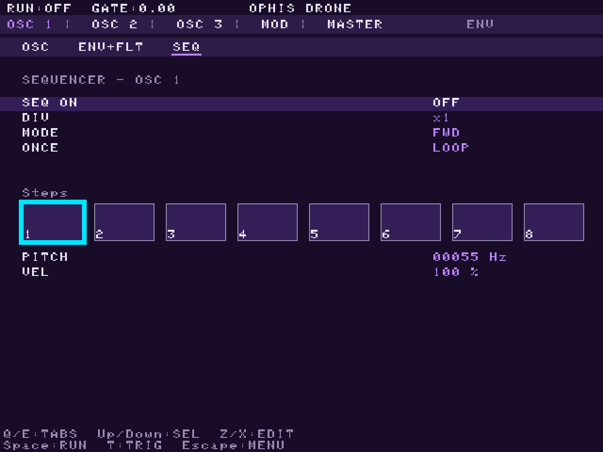
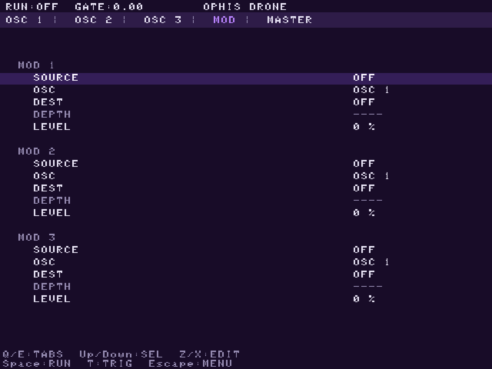
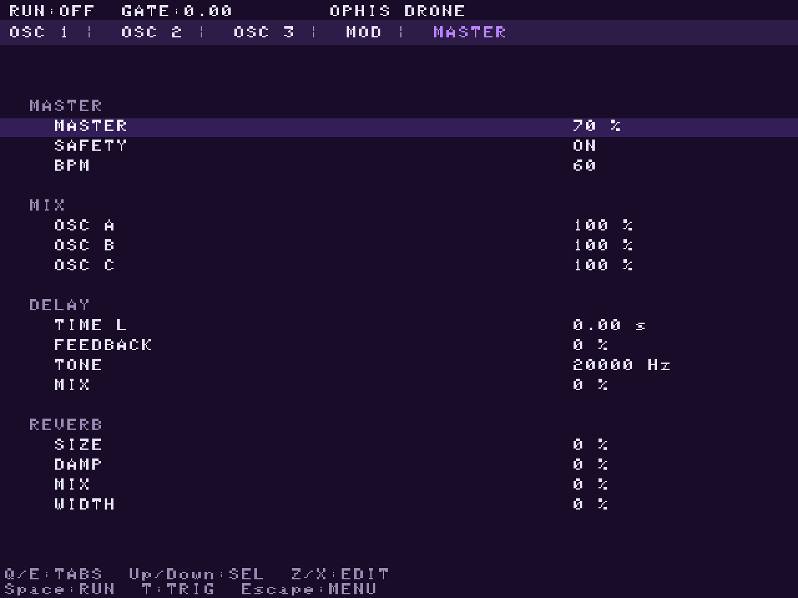
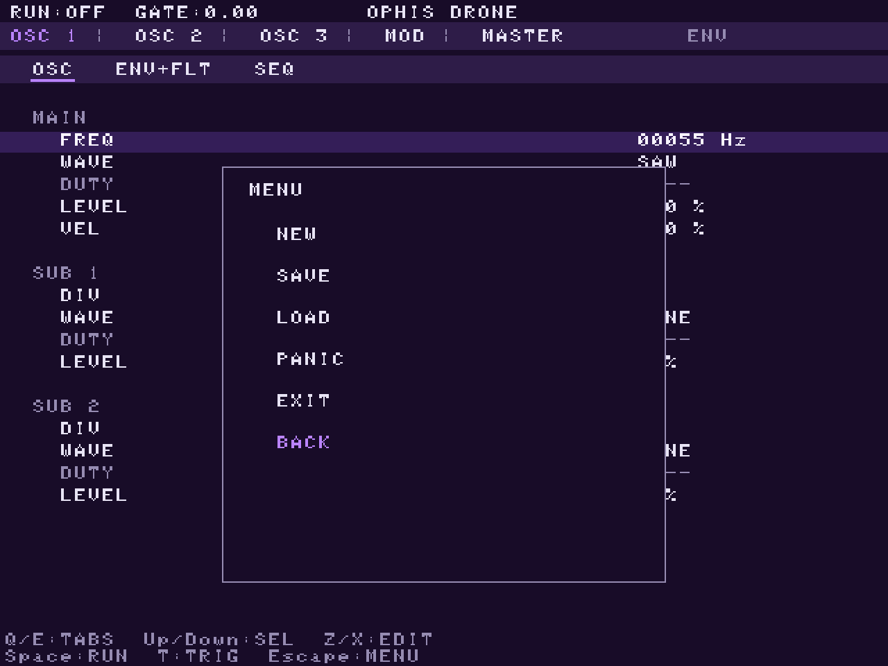

# OPHIS-DRONE — hands-on manual

Three-oscillator drone synth with a modulation matrix, 3 sequencers and
master FX. Desktop (SDL2) and R36S handheld from one build.

## 1. Layout

Five top tabs: **OSC 1 / OSC 2 / OSC 3 / MOD / MASTER** (`Q`/`E` cycle).
OSC tabs have sub-tabs: **OSC · ENV+FLT · SEQ** (`←`/`→` on the sub-tab
row; `↑`/`↓` move between rows, `↓` enters the page).

## 2. Editing values

`X` increases, `Z` decreases the selected value (R36S: `X`/`Y`).
Every field **rolls over** at its bounds — nothing clamps.

**Frequency rows** (FREQ, CUTOFF, TONE, SEQ PITCH) are 5-digit odometer
boxes: `←`/`→` move the digit cursor (the small underline), `X`/`Z`
step that digit with true carry. Far-left digit sweeps the whole range
in ~20 presses; rightmost digit = 1 Hz precision. Going below the floor
rolls to the top and vice versa.

## 3. Sound: OSC page

- **FREQ / WAVE / DUTY / LEVEL / VEL** — the main oscillator.
- **SUB 1 / SUB 2** — subharmonic voices playing `FREQ / DIV`
  (integer 1..16). Their **LEVEL** mixes them into the oscillator; 0 =
  silent. Subs modulate only via the MOD matrix.

## 4. Envelope + filter (ENV+FLT)

ADSR (seconds, log scale) + filter: mode LP/HP/BP/BR, cutoff, resonance,
ENV (envelope -> cutoff sweep amount), poles 12/24 dB.

## 5. Sequencer (SEQ)

8 steps. `SEQ ON` runs it; **PITCH/VEL** edit the selected step's pitch
and velocity (VEL 0 = silent step). The **STEP** row selects the step
(`←`/`→` or `X`/`Z`); DIV slows it (step = 60/BPM/4 × div); MODE =
fwd/pingpong/oddeven/random/markov; ONCE = one pass then silence.

## 6. MOD — the matrix

16 slots. The **SLOT** row selects the slot (`←`/`→` or `X`/`Z`,
rolls over); the five rows below edit it: **SOURCE** (any osc or sub,
any chain) → **TARGET** (the chain it acts on) → **DEST** (PITCH
vibrato · PHASE · AMP · FLT CUT · FLT RES · RING · FM) → **DEPTH**,
plus **LEVEL** — the source's raw audio blended into that chain
(works with DEST off). Self-routing is legal; sources read one
sample late.

## 7. MASTER

**MASTER** level, **SAFETY** (HP/LP guard filter), **BPM** (one global
tempo), **MIX A/B/C** — how much of each finished chain reaches the
output (0 = silent there, but it still feeds the matrix). Then DELAY
and REVERB.

## 8. Menu, presets, transport

`Escape` opens the menu: **NEW** (factory defaults), **SAVE**, **LOAD**,
**PANIC** (all notes off, filters cleared), **EXIT**.

`Space` (R36S `A`) = RUN/STOP — runs the sequencers, or in direct mode
retrigs at the chain's VEL. `T` (R36S `B`) = TRIGGER/retrigger.

## 9. Keys

| Action | Desktop | R36S |
|---|---|---|
| Tabs | `Q` / `E` | `L` / `R` shoulder |
| Sub-tabs | `←`/`→` on the sub-tab row | same |
| Move cursor | `↑` / `↓` | d-pad `UP`/`DOWN` |
| Digit cursor / step select | `←` / `→` | d-pad `LEFT`/`RIGHT` |
| Edit | `Z` / `X` | `Y` / `X` |
| RUN / TRIG | `Space` / `T` | `A` / `B` |
| Menu | `Escape` | `Start` (or `Select`) |

## 10. Presets on disk

Plain JSON next to the executable (`presets/`). The LOAD picker creates
the folder if missing. Saving overwrites by name.
